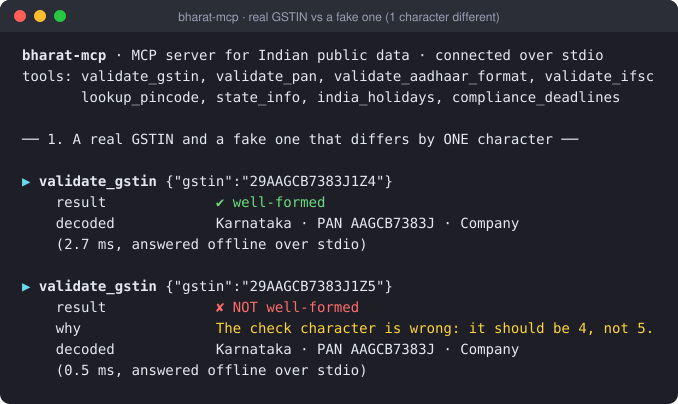
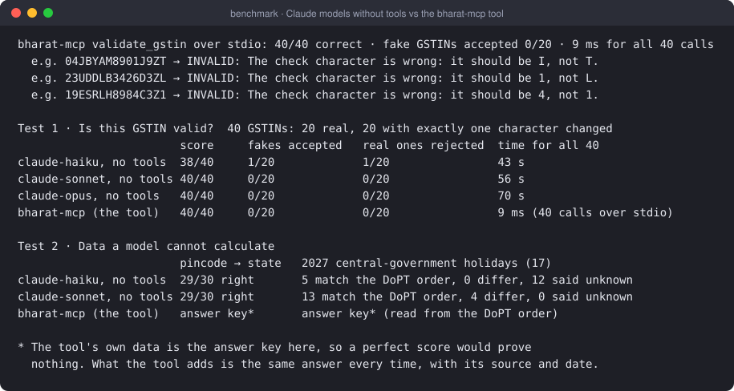
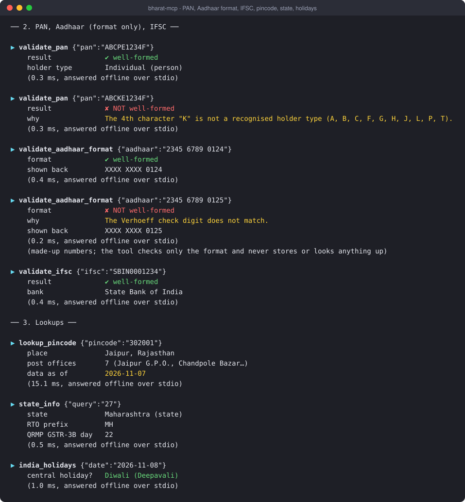
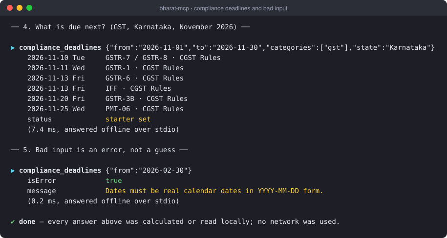
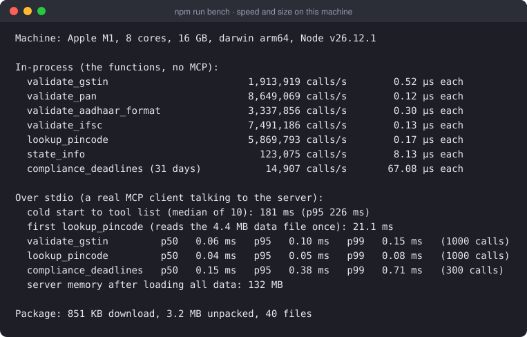
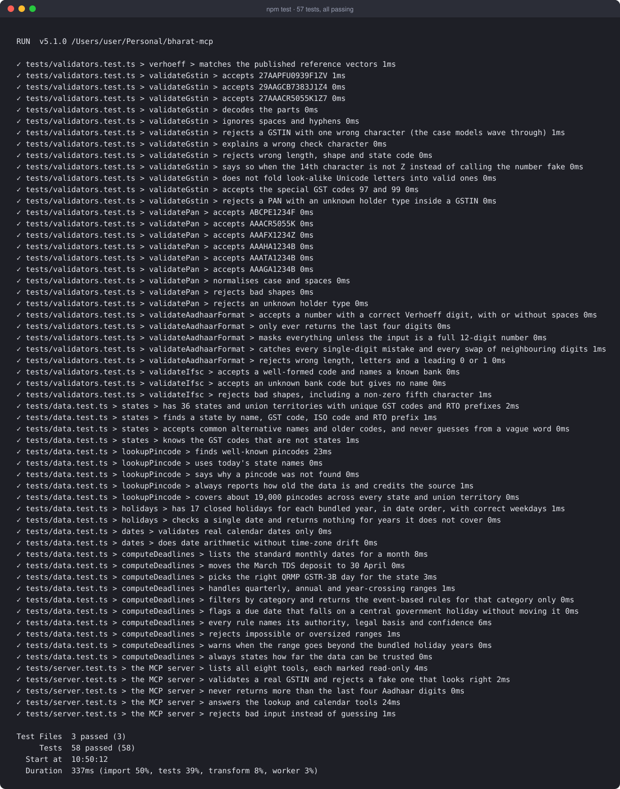

# bharat-mcp

**Give your AI agent accurate Indian GST, PAN, pincode and compliance knowledge.**

[](https://github.com/lllakshit/bharat-mcp/actions/workflows/ci.yml)
[](https://www.npmjs.com/package/bharat-mcp)
[](LICENSE)

An [MCP](https://modelcontextprotocol.io) server with eight small tools for Indian data that an AI agent should not work out in its head: checksums, code tables, lookups and due dates. It runs **offline**. The checksums are calculated, the datasets ship inside the package, and nothing you type is sent anywhere. Every answer says what it is based on and how old that data is.



*Real output from the built server over stdio, saved by `npm run proof`. The fake differs from the real one in the last character only.*

## Does it actually help? What we measured

We put the same questions to Claude models **with no tools** and compared them with the tool. Everything below is reproducible; see [Reproduce everything](#reproduce-everything).



**Test 1: is this GSTIN valid?** 40 GSTINs, 20 real and 20 with exactly one character changed (so the shape is right and only the checksum can tell). The answer key is the checksum itself. A separate Python implementation of the checksum agrees with this package on 20,000 random strings ([cross-check](docs/img/crosscheck.svg)), and the algorithm reproduces the commonly published sample GSTINs used in the tests.

- **Opus and Sonnet scored 40/40 with no tools.** Haiku scored 38/40: it accepted one fake (`25WKRPW1917M3ZS`) and rejected one real GSTIN (`01RLFCG9549K2Z7`).
- The tool scored 40/40 in 9 ms for all 40 calls over stdio. The three models took 43 to 70 seconds for the same 40 questions.

So, to be straightforward about it: **current Claude models are mostly right on this when asked carefully, and we could not reproduce "an AI approves a fake GSTIN" with Sonnet or Opus.** What the tool gives you is a different kind of answer: the same one every time, in microseconds, with the reason ("the check character should be 4, not 5") and a clear note that *well-formed is not the same as registered*. A cheaper model, a rushed prompt or a long agent run is where a slip like Haiku's shows up.

**Test 2: data a model cannot calculate.**

- **Pincode to state (30 random pincodes):** both Haiku and Sonnet got 29/30. Both put `262122` (Pilibhit) in Uttarakhand instead of Uttar Pradesh. We do not headline the *district* results, because India Post lists post-office divisions, not always revenue districts, and some names changed after our data (Allahabad is now Prayagraj, Karimganj is now Sribhumi). That is also a limit of this package: see [data sources](#data-sources-and-limits).
- **2027 Central Government holidays (17):** the DoPT order for 2027 was issued in July 2026. **Haiku matched 5 and said "unknown" for 12**, which is the honest answer. **Sonnet matched 13 and differed on 4, with no hedging**, including Dussehra on 20 October 2027, which is the 2026 date (the order says 9 October 2027). Holi, Muharram and Guru Nanak's Birthday differ by one day; the order is the authority for these, not an astronomical calendar.

**How the model runs were made, and their limits.** Each model was a fresh Claude Code subagent given one prompt with all the questions and told not to use tools, code, files or the web. The transcripts were checked afterwards: the only tool call in every run was the one that returns the answer. Limits: all 40 GSTINs went into one prompt (a single casual question may behave differently); only Claude models were tested; 40 questions is a small sample (one mistake is 2.5 points); and the tool's own data cannot be used to prove the tool right, which is why Test 2 has no score for it. The raw answers and scored results are in [`bench/results/`](bench/results/) and the method is in [`bench/llm/`](bench/llm/). To test your own model: `npm run bench:llm -- --backend api --model <model-id>` (needs `ANTHROPIC_API_KEY` in your shell). That runner is tested with a stand-in model only; the Claude results above were produced the way described here, not with it.

## Tools

| Tool | What it does | Works offline |
|---|---|---|
| `validate_gstin` | 15-character structure, state code, embedded PAN and the mod-36 check character, with decoded parts. Regular-taxpayer GSTINs only (14th character Z) | yes |
| `validate_pan` | Shape plus holder type (individual, company, firm, HUF, trust and so on) | yes |
| `validate_aadhaar_format` | Format and Verhoeff checksum **only**. Nothing is stored or looked up; only the last 4 digits are returned | yes |
| `validate_ifsc` | IFSC format and bank code, with the bank name for well-known banks | yes |
| `lookup_pincode` | State, district and post offices for a 6-digit pincode | yes (bundled data) |
| `state_info` | State and union territory by name, GST code, ISO code or RTO prefix; QRMP GSTR-3B due-day group | yes |
| `india_holidays` | Central Government closed holidays for 2026 and 2027, or check one date | yes |
| `compliance_deadlines` | GST, TDS, advance tax, EPF/ESI and ROC due dates in a date range, with legal basis and authority | yes |

All tools are read-only.

## See it work in a terminal

```bash
git clone https://github.com/lllakshit/bharat-mcp.git
cd bharat-mcp && npm install && npm run build
npm run demo
```

`npm run demo` starts the built server over stdio, exactly as Claude Desktop or Cursor would, and calls every tool:





Bad input comes back as an MCP error (`isError: true`), not as a guess.

## Install

Requires Node 18 or newer.

**Claude Desktop**: add this to `claude_desktop_config.json` (on macOS: `~/Library/Application Support/Claude/claude_desktop_config.json`), then restart Claude:

```json
{
  "mcpServers": {
    "bharat": {
      "command": "npx",
      "args": ["-y", "bharat-mcp"]
    }
  }
}
```

**Cursor**: add the same block to `~/.cursor/mcp.json` (or `.cursor/mcp.json` in a project).

**Claude Code**:

```bash
claude mcp add bharat -- npx -y bharat-mcp
```

**From source** (before or instead of npm): `npm run build`, then use `"command": "node", "args": ["/path/to/bharat-mcp/dist/cli.js"]` in the config above.

Then ask your agent: *"Is GSTIN 29AAGCB7383J1Z5 valid?"* It should call `validate_gstin` and tell you the check character is wrong.

You can also use the functions directly: `import { validateGstin } from "bharat-mcp"`.

## Speed and size

Measured on Apple M1 (8 cores, 16 GB, darwin arm64, Node v26.12.1) with `npm run bench`:



| | |
|---|---|
| `validate_gstin`, in-process | 1,913,919 calls/s (0.52 µs each) |
| `validate_gstin`, over stdio | p50 0.06 ms, p99 0.15 ms |
| `lookup_pincode`, over stdio | p50 0.04 ms (first call 21 ms, which reads the data file once) |
| `compliance_deadlines`, over stdio | p50 0.15 ms |
| Cold start to tool list | 181 ms median |
| Memory after loading all data | about 132 MB |
| Package | 851 KB download, 3.2 MB unpacked, 40 files |

These are one machine and one run. Treat them as the order of magnitude, not a guarantee.

## Tests

58 tests cover the validators (including every single-character mistake in the sample GSTINs and Aadhaar numbers), the data, the date logic and the MCP server end to end. CI runs them on Node 22 and 24, runs the built server on Node 18 and 20, and audits the dependencies.



## Data sources and limits

Short version; the full detail is in [DATA-SOURCES.md](DATA-SOURCES.md).

| Data | Source | As of | Limit |
|---|---|---|---|
| Pincodes | [GeoNames](https://www.geonames.org) postal codes for India, **CC BY 4.0**, built from the India Post list | downloaded 7 Nov 2026 | District names follow India Post and can be older than the official name (for example Allahabad, now Prayagraj). A pincode created after the download is missing. |
| States, GST codes, RTO prefixes | CBIC/GSTN GST state codes, ISO 3166-2:IN, MoRTH series | 7 Nov 2026 | Hand-curated |
| Holidays | DoPT orders for 2026 (dated 3 Jul 2025) and 2027 (dated 16 Jul 2026; checked against the official memorandum) | 7 Nov 2026 | Central Government (Delhi) closed holidays only. No state, bank or stock-exchange holidays. Moon-dependent dates can shift. |
| Compliance deadlines | Statutory due dates under the CGST Rules, Income-tax rules, EPF/ESI and Companies Act | 7 Nov 2026 | **Starter set.** Standard dates only; government extensions are not included. Checked against secondary calendars, not yet line by line against each notification, so every entry is marked `medium` confidence. |

Things this server deliberately does **not** do:

- It does not tell you a GSTIN, PAN or Aadhaar number is **real or registered**. A pass (`valid_format: true`) means well-formed. Only the GST portal, the Income Tax Department or UIDAI can say more.
- It does not look up Aadhaar numbers, store them, or log them.
- It does not scrape government portals or captcha-protected pages.
- It does not recognise TDS/TCS, UN-body or non-resident GSTIN formats; they are reported as not supported, not as fake.
- It does not include IFSC branch data yet. The RBI data has no clear reuse licence, so only the format and bank code are checked.
- It does not shift a due date that falls on a Sunday or holiday. It flags it.

Every tool result carries its own `note` or `data_as_of`, so a model reading the answer can see how far to trust it.

## Reproduce everything

```bash
npm install && npm run build
npm test                          # 58 tests
npm run demo                      # the terminal tour above
npm run bench                     # speed and size
python3 bench/crosscheck.py       # independent Python checksum vs this package, 20,000 strings
node bench/llm/tool-check.mjs     # the 40 GSTIN questions put to the tool over stdio
node bench/llm/report.mjs         # the benchmark table, from the saved results
npm run proof                     # regenerates every screenshot in docs/img from real runs
```

The screenshots in `docs/img` are SVG renderings of real terminal output. The raw text of each run is in [`docs/proof/`](docs/proof/), so you can compare them line by line.

## Develop

```bash
npm install
npm test
npm run typecheck
npm run build
npm run smoke     # starts the built server over stdio and calls it
```

Rebuild the pincode file from GeoNames: download `IN.zip` from https://download.geonames.org/export/zip/, unzip it, then `node scripts/build-pincodes.mjs path/to/IN.txt`.

## Contributing

Issues and pull requests are welcome, especially:

- a wrong or out-of-date due date (please link the official notification),
- a state or bank code that is missing,
- tell me which Indian data you want next.

## Licence

Code: [MIT](LICENSE). Bundled data keeps the licence of its source; see [DATA-SOURCES.md](DATA-SOURCES.md).

Postal code data: © [GeoNames](https://www.geonames.org), licensed under [CC BY 4.0](https://creativecommons.org/licenses/by/4.0/).
